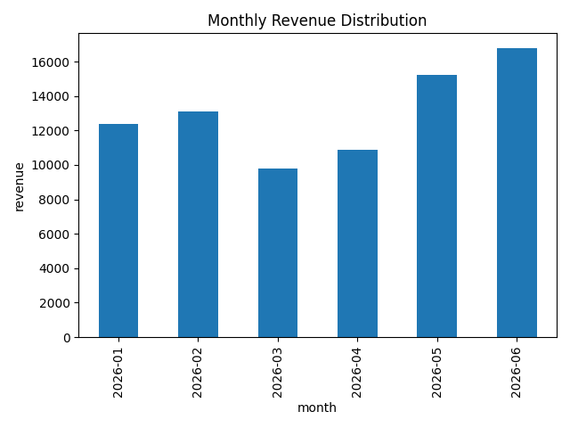

<div>
    
</div>

---

graphout is a local AI agent that fully automates data visualisation. Hopefully I don't ever have to make a graph on Excel again and crashout.

## Demo

```sh
uv run python -m src.main assets/demo.csv -o assets/demo.png
```


